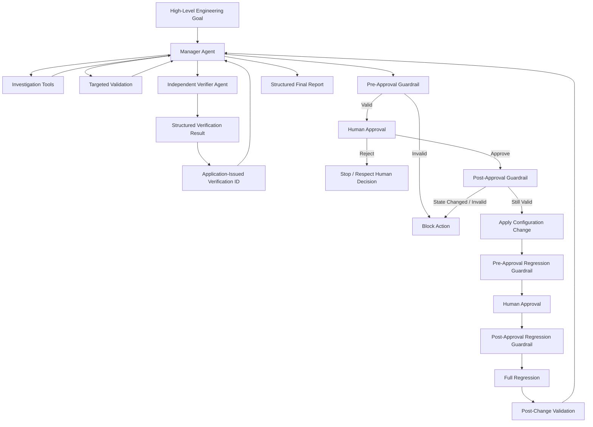

# AI agents for ADAS Validation - Build from scratch
# From Tool Calling to Governed Multi-Agent Systems

### A progressive Python project culminating in a governed multi-agent ADAS HIL validation workflow

This project is a hands-on exploration of how an AI application can evolve from a simple LLM call into an autonomous, verified, governed, and observable multi-agent system.

The early levels use a calculator and simulated vehicle-status examples to introduce core concepts such as tool calling, multi-tool orchestration, persistent memory, semantic retrieval, and agent loops.

The later levels apply those concepts to a **fully simulated ADAS Hardware-in-the-Loop (HIL) regression investigation**, eventually introducing independent verification, application guardrails, human-in-the-loop authorization, resumable workflows, multi-agent orchestration, and tracing.

> **Python:** The project uses Python 3 and was developed and tested primarily with **Python 3.14**.

> **Important:** The ADAS/HIL environment in this repository is entirely simulated. No real vehicle, ECU, HIL bench, production test infrastructure, or safety-critical system is controlled by this project.

---

## What This Project Demonstrates

The project progressively introduces:

- LLM API integration
- Function/tool calling
- Autonomous tool selection
- Multi-step agent loops
- Multiple tools in one workflow
- In-process conversation memory
- Persistent SQLite memory
- Embeddings and semantic retrieval with ChromaDB
- Memory-based RAG
- Goal-driven autonomous investigation
- Evidence-based root-cause analysis
- Independent LLM verification
- Verification-driven retry and experimentation
- Deterministic application guardrails
- Human-in-the-loop authorization
- Separation of AI reasoning from system authority
- Serializable and resumable agent execution
- Pre- and post-approval validation
- Manager/specialist multi-agent orchestration
- Structured outputs using Pydantic
- Application-issued verification IDs
- Agent tracing and observability

The intention is not only to demonstrate what an AI agent can do, but also to explore **how increasingly autonomous agents should be constrained, verified, observed, and governed**.

---

# Agent Evolution

```text
LEVEL 1   LLM

LEVEL 2   Single tool

LEVEL 3   Multi-tool autonomy

LEVEL 4   Memory
          ├─ Python
          ├─ SQLite
          └─ ChromaDB / semantic retrieval

LEVEL 5A  Autonomous investigation

LEVEL 5B  Independent verification + retry

LEVEL 5C  Governance + human authority

BONUS A   OpenAI Agents SDK runtime

BONUS B   Native HITL
          + RunState
          + tool guardrails
          + pause/resume

BONUS C   Manager Agent
          + Verifier Agent as a tool
          + application-issued verification ID
          + guardrails
          + HITL
          + tracing / observability
```

Level 1 is conceptual and does not have a separate script. It represents a normal LLM interaction without tools.

The first executable stage in the repository is Level 2.

---

# Level Overview

| Level | What it adds | Script |
|---|---|---|
| 1 | LLM only — model responds without tools | Conceptual |
| 2 | One function tool: `calculator` | `calc_agent.py` |
| 3 | Multiple tools and autonomous tool selection | `calc_agent_l3.py` |
| 4A | In-process Python conversation memory | `calc_agent_l4.py` |
| 4B | Persistent SQLite memory | `calc_agent_l4b_sqlite.py` |
| 4C | Semantic memory using embeddings and ChromaDB | `calc_agent_l4c_chromadb.py` |
| 5A | Goal-driven autonomous HIL investigation | `adas_agent_l5a.py` |
| 5B | Independent verification, experimentation, and retry | `adas_agent_l5b.py` |
| 5C | Guardrails, human approval, controlled actions, and audit logging | `adas_agent_l5c.py` |
| Bonus A | Reimplementation using the OpenAI Agents SDK | `adas_agent_bonus_a.py` |
| Bonus B | Native HITL, `RunState`, tool guardrails, pause/resume | `adas_agent_bonus_b.py` |
| Bonus C | Manager + Verifier Agent, governed execution, tracing | `adas_agent_bonus_c.py` |

---

# Final Simulated ADAS/HIL Scenario

Levels 5 and the Bonus stages use a deterministic simulated HIL regression:

```text
Run ID:
HIL_NIGHTLY_2026_10_26

Build:
4821

Total tests:
500

Passed:
463

Failed:
37

Baseline failure rate:
37 / 500 = 7.4%
```

The agent groups the failures into three categories:

```text
G1 — ECU flashing
30 failures

G2 — Camera synchronization
5 failures

G3 — Perception
2 failures
```

The dominant ECU flashing group represents:

```text
30 / 37 = 81.08%
```

of all regression failures.

## Observed dominant mechanism

The simulated evidence shows:

```text
HIL flashing harness timeout:
10 seconds

Observed ECU boot-ready time:
~13.8 seconds
```

The harness therefore aborts before the ECU becomes ready.

A targeted experiment increases the timeout to:

```text
15 seconds
```

Result:

```text
30 / 30 affected flashing tests PASS
```

This experimentally supports the **timeout mismatch** as the dominant failure mechanism.

The project deliberately avoids claiming that a bootloader security/integrity change caused the increased latency because the available evidence does not isolate that causal relationship.

---

## Governed remediation result

After verification, guardrails, and human approval:

```text
Configuration

Before:
10 seconds

After:
15 seconds
```

A complete simulated post-change regression produces:

```text
Total tests:
500

Passed:
493

Failed:
7

Post-change failure rate:
7 / 500 = 1.4%
```

The dominant flashing failures change from:

```text
30 → 0
```

The seven remaining failures are:

```text
Camera synchronization:
5

Perception:
2
```

Therefore the simulated intervention changes the overall failure rate from:

```text
7.4% → 1.4%
```

> All regression results in this section are simulated deterministic data used to demonstrate agent architecture and engineering workflows.

---

# Final Bonus C Architecture

Bonus C is the final architecture in the project.

The Manager Agent owns the workflow while delegating bounded technical review to an independent Verifier Agent.



The design intentionally keeps several responsibilities separate:

```text
Manager Agent
→ investigates and coordinates

Verifier Agent
→ independently reviews the technical conclusion

Application guardrails
→ determine whether an action is allowed

Human reviewer
→ authorizes sensitive actions

Tools
→ perform the actual side effects
```

The LLM that proposes an action is therefore **not the authority that grants itself permission to execute it**.

---

# How Each Stage Works

## Level 1 — LLM

Level 1 represents a normal language-model interaction.

```text
User
 ↓
LLM
 ↓
Answer
```

There are no tools, external actions, or persistent memory.

No separate Level 1 script is included.

---

## Level 2 — Single Tool

Script:

```text
calc_agent.py
```

The model receives one tool:

```python
calculator(a, b, operation)
```

If the model determines that calculation is required, it returns a function call.

The Python application:

1. detects the tool call,
2. parses its arguments,
3. executes the calculator,
4. returns the tool result to the model,
5. receives the final answer.

Example:

```text
You: What is 8 multiplied by 23?

Agent → calculator

Tool result:
184

Agent:
184
```

This introduces the fundamental concept:

> An LLM can reason about when to use a tool, while deterministic Python code performs the actual operation.

---

## Level 3 — Multiple Tools

Script:

```text
calc_agent_l3.py
```

The agent receives several tools, including:

- calculator
- current time
- simulated vehicle status

The model decides:

- which tool to use,
- which arguments to provide,
- whether another tool is required,
- when enough information exists to answer.

The application introduces an autonomous tool loop:

```text
Think
 ↓
Choose tool
 ↓
Execute
 ↓
Observe result
 ↓
Choose another tool if necessary
 ↓
Answer
```

---

# Level 4 — Memory

Level 4 introduces progressively more capable memory.

## Level 4A — Python memory

Script:

```text
calc_agent_l4.py
```

Conversation history is stored in a Python data structure.

The agent can reference information from earlier turns during the same execution.

The memory disappears when the process terminates.

---

## Level 4B — SQLite persistent memory

Script:

```text
calc_agent_l4b_sqlite.py
```

Conversation memory is stored in:

```text
agent_memory.db
```

The agent can therefore recall information across program restarts.

This introduces persistence:

```text
Session 1
 ↓
SQLite
 ↓
Program exits
 ↓
Session 2
 ↓
Retrieve previous memory
```

---

## Level 4C — Semantic memory

Script:

```text
calc_agent_l4c_chromadb.py
```

Memory is stored using:

- embeddings
- ChromaDB
- similarity search

Instead of retrieving only the most recent messages, the application retrieves memories that are **semantically related to the current query**.

Conceptually:

```text
New query
 ↓
Embedding
 ↓
Vector similarity search
 ↓
Relevant past memories
 ↓
LLM context
```

This creates a simple form of **memory RAG**.

---

# Level 5 — Autonomous ADAS/HIL Investigation

Level 5 changes the domain from calculator examples to a simulated ADAS/HIL validation workflow.

---

## Level 5A — Autonomous Investigation

Script:

```text
adas_agent_l5a.py
```

The agent receives a high-level engineering goal instead of a predefined sequence of calls.

It autonomously:

```text
Plans
 ↓
Collects evidence
 ↓
Inspects regression failures
 ↓
Calculates metrics
 ↓
Correlates logs and build changes
 ↓
Forms a technical conclusion
```

The workflow follows:

```text
Plan → Act → Observe → Finish
```

The agent investigates:

- regression summary
- grouped failures
- failure logs
- build changes
- known issues
- engineering percentages

This introduces **goal-driven autonomous investigation**.

---

## Level 5B — Independent Verification and Retry

Script:

```text
adas_agent_l5b.py
```

Level 5B introduces a second verification path.

The investigator proposes a conclusion, but that conclusion is not automatically accepted.

The verifier checks:

- mathematical consistency,
- supporting evidence,
- evidence IDs,
- experimental confirmation,
- causal wording,
- contradictory evidence.

If the evidence is insufficient:

```text
Candidate conclusion
 ↓
Verifier
 ↓
REJECT
 ↓
Feedback
 ↓
Additional experiment
 ↓
Retry
 ↓
Verifier
 ↓
APPROVE
```

In the demonstrated run, the first conclusion was rejected because experimental confirmation was missing.

The agent then autonomously performed a targeted experiment:

```text
Timeout:
15 seconds

Affected tests:
30

Passed:
30
```

The improved conclusion was then independently approved.

This stage demonstrates:

> Autonomous agents should be able not only to act, but also to challenge and correct their own proposed conclusions through an independent verification process.

---

## Level 5C — Governed Autonomous Agent

Script:

```text
adas_agent_l5c.py
```

Level 5C introduces system authority and human control.

A technically correct recommendation does **not** automatically grant the agent permission to modify configuration.

Sensitive actions include:

```text
apply_timeout_change

trigger_full_regression
```

The workflow becomes:

```text
Investigate
 ↓
Verify
 ↓
Propose action
 ↓
Application guardrail
 ↓
Human approval
 ↓
Execute
 ↓
Validate outcome
 ↓
Audit
```

Events are recorded in:

```text
l5c_audit_log.jsonl
```

This stage introduces one of the project's central design principles:

> **Verification is not authorization.**

An action may be technically correct but still require independent policy checks and explicit human authority before execution.

---

# Bonus A — OpenAI Agents SDK

Script:

```text
adas_agent_bonus_a.py
```

Bonus A rebuilds the autonomous HIL workflow using the OpenAI Agents SDK.

The manually implemented orchestration from Level 5A:

```text
Responses API
 ↓
manual agent loop
 ↓
tool-call detection
 ↓
argument parsing
 ↓
tool router
 ↓
response chaining
 ↓
termination logic
```

is largely replaced by:

```text
Agent
 ↓
Runner
 ↓
Function tools
 ↓
Structured output
```

Tools are defined directly from Python functions, while the SDK handles the repeated model/tool execution loop.

The final result uses a structured Pydantic output model.

Bonus A therefore demonstrates the difference between:

```text
building an agent runtime manually

vs.

using an agent framework
```

---

# Bonus B — Native HITL and Resumable Execution

Script:

```text
adas_agent_bonus_b.py
```

Bonus B introduces:

- native SDK human-in-the-loop interruptions,
- `RunState`,
- serialized workflow state,
- pause/resume,
- tool input guardrails,
- pre-approval validation,
- post-approval revalidation.

For a sensitive action:

```text
Agent proposes action
 ↓
Pre-approval guardrail
 ↓
Human approval
 ↓
Post-approval guardrail
 ↓
Tool execution
```

The two guardrail checks serve different purposes.

### Pre-approval guardrail

Determines:

> Is this proposal valid enough that a human should even be asked to approve it?

Invalid actions are blocked before disturbing the reviewer.

### Post-approval guardrail

Determines:

> Is the action still valid immediately before execution?

This protects against system state changing between approval request and execution.

The pattern helps mitigate a common **time-of-check/time-of-use** problem.

Paused workflow state is serialized to a local RunState snapshot and can later be reloaded and resumed.

---

# Bonus C — Governed Multi-Agent System

Script:

```text
adas_agent_bonus_c.py
```

Bonus C is the final technical stage.

It introduces:

- Manager Agent
- independent Verifier Agent
- Verifier Agent exposed as a specialist tool
- structured verification result
- application-issued verification ID
- candidate fingerprint
- application guardrails
- HITL authorization
- RunState pause/resume
- tracing
- custom observability spans

The Manager retains ownership of the overall workflow.

The Verifier performs one bounded task:

> Independently evaluate whether the technical investigation is sufficiently supported.

If approved, trusted application code generates a verification ID.

The Manager must present that ID when proposing the configuration change.

Conceptually:

```text
Manager conclusion
 ↓
Independent Verifier Agent
 ↓
Structured verdict
 ↓
Application processes verdict
 ↓
Verification ID
 ↓
Sensitive-action guardrail
 ↓
Human approval
 ↓
Execution
```

The Manager therefore cannot simply claim:

```text
"The verifier approved this."
```

The application requires evidence that the real Verifier Agent actually returned an approved result.

---

# Tracing and Observability

Bonus C wraps the workflow in a named trace.

The SDK records information such as:

- Manager Agent activity
- Verifier Agent execution
- model generations
- function-tool calls
- guardrails
- human approval events
- custom spans
- final workflow execution

The terminal output provides the human-readable execution story, while traces provide a more detailed view of the underlying agent workflow.

The final Bonus C run also reports:

```text
Model requests
Input tokens
Output tokens
Total tokens
Final active agent
Verifier score
Candidate fingerprint
Trace ID
```

This makes it possible to reason not only about correctness, but also about the operational cost and complexity of increasingly sophisticated agent architectures.

---

# Design Principles

## 1. Evidence before conclusion

The agent must inspect observable evidence before declaring a root cause.

A plausible explanation is not enough.

---

## 2. Experimental confirmation matters

Correlation alone should not automatically become causality.

In the simulated HIL example:

```text
Security/integrity change introduced
+
boot latency increased
```

does not prove:

```text
Security change caused the latency increase
```

What the experiment actually confirms is:

```text
10-second timeout
<
~13.8-second ECU readiness
```

and increasing the timeout beyond ECU readiness eliminates the dominant failure group.

---

## 3. Verification is not authorization

The Verifier answers:

> Is this technically supported?

The human reviewer answers:

> Do I authorize this action?

These are intentionally separate responsibilities.

---

## 4. AI intelligence is separate from system authority

The LLM may:

- investigate,
- reason,
- recommend,
- plan,
- propose an action.

Application code determines:

- whether the action is allowed,
- whether prerequisites exist,
- whether the request satisfies policy.

The human determines:

- whether sensitive execution is authorized.

---

## 5. Guardrails should fail closed

If required evidence, verification, configuration state, or authorization is missing, the sensitive tool should not execute.

---

## 6. Revalidate immediately before execution

An action that was safe when proposed may no longer be safe after time has passed.

Therefore Bonus B and Bonus C perform:

```text
Pre-approval validation

and

Post-approval validation
```

before a side effect occurs.

---

# Requirements

- Python 3
- OpenAI API key
- Virtual environment recommended

Core dependencies include:

```text
openai
chromadb
openai-agents
```

Install project dependencies:

```powershell
pip install -r requirements.txt
```

---

# Setup

## 1. Create a virtual environment

Windows:

```powershell
python -m venv .venv
.\.venv\Scripts\Activate.ps1
```

macOS / Linux:

```bash
python3 -m venv .venv
source .venv/bin/activate
```

---

## 2. Install dependencies

```powershell
pip install -r requirements.txt
```

---

## 3. Configure the OpenAI API key

Windows PowerShell:

```powershell
$env:OPENAI_API_KEY="your-api-key"
```

macOS / Linux:

```bash
export OPENAI_API_KEY="your-api-key"
```

The scripts initialize the OpenAI client without embedding credentials in source code and read the API key from the environment.

Never commit an API key to Git.

---

# Running the Project

Run the stage you want to explore.

```text
python calc_agent.py

python calc_agent_l3.py

python calc_agent_l4.py

python calc_agent_l4b_sqlite.py

python calc_agent_l4c_chromadb.py

python adas_agent_l5a.py

python adas_agent_l5b.py

python adas_agent_l5c.py

python adas_agent_bonus_a.py

python adas_agent_bonus_b.py

python adas_agent_bonus_c.py
```

Level 2 and Level 3 accept a user prompt.

Example:

```text
You: What is 12 plus 8?

You: Multiply 8 and 23

You: Divide 100 by 4
```

Level 4 supports conversational interaction and can be exited using:

```text
exit
```

or:

```text
quit
```

Levels 5 and Bonus A–C run the simulated ADAS/HIL investigation workflow.

Some governed stages pause and explicitly request human authorization before sensitive actions.

---

# Project Layout

```text
calc_agent/

├── calc_agent.py
│   └── Level 2 — single-tool agent
│
├── calc_agent_l3.py
│   └── Level 3 — multi-tool agent
│
├── calc_agent_l4.py
│   └── Level 4A — Python memory
│
├── calc_agent_l4b_sqlite.py
│   └── Level 4B — persistent SQLite memory
│
├── calc_agent_l4c_chromadb.py
│   └── Level 4C — semantic memory / retrieval
│
├── adas_agent_l5a.py
│   └── Level 5A — autonomous HIL investigation
│
├── adas_agent_l5b.py
│   └── Level 5B — independent verification + retry
│
├── adas_agent_l5c.py
│   └── Level 5C — governed autonomous agent
│
├── adas_agent_bonus_a.py
│   └── Bonus A — OpenAI Agents SDK
│
├── adas_agent_bonus_b.py
│   └── Bonus B — native HITL + RunState
│
├── adas_agent_bonus_c.py
│   └── Bonus C — Manager + Verifier + tracing
│
├── requirements.txt
│
└── README.md
```

---

# Local Runtime Artifacts

Some scripts generate local runtime data.

These files/directories are not source code:

```text
agent_memory.db

chroma_memory/

l5c_audit_log.jsonl

.cache/bonus_b_hitl_state.json

.cache/bonus_c_hitl_state.json
```

These should normally be excluded from version control using `.gitignore`.

---

# Limitations

This repository is an educational and portfolio project designed to demonstrate agent architecture.

It is **not a production automotive validation system**.

Important limitations include:

- HIL results are simulated and deterministic.
- No real vehicle is connected.
- No real ECU is flashed.
- No physical HIL bench is controlled.
- No production CI/CD environment is accessed.
- No real engineering configuration is modified.
- Human approval occurs locally in the command-line application.
- Some application state is stored locally or in process memory.
- Verification IDs are demonstration-level application identifiers, not cryptographically signed authorization tokens.
- The simulated tools intentionally simplify real automotive validation infrastructure.

A production implementation would require additional engineering around:

- authentication,
- authorization,
- secure secrets management,
- persistent workflow storage,
- distributed concurrency,
- configuration versioning,
- rollback,
- immutable audit records,
- production observability,
- failure recovery,
- secure human approval interfaces,
- access control,
- formal safety processes,
- automotive cybersecurity requirements,
- integration with actual HIL/CI infrastructure.

For example, a production verification record should be bound to the exact:

```text
candidate conclusion
+
evidence snapshot
+
proposed action
+
configuration version
+
review identity
+
timestamp / expiry
```

rather than relying only on an in-process verification registry.

---

# Security Notes

- Never commit API keys.
- Store secrets in environment variables or an appropriate secrets manager.
- Treat serialized RunState files as potentially sensitive workflow state.
- Do not expose approval state or execution snapshots publicly.
- Real side-effecting tools should enforce authorization outside the LLM.
- Do not rely solely on prompt instructions for security-sensitive controls.

---

# Key Takeaway

The main lesson of this project is not simply that LLMs can call tools.

The progression shows how agent systems evolve:

```text
Reason
 ↓
Use tools
 ↓
Choose among tools
 ↓
Remember
 ↓
Retrieve relevant memory
 ↓
Plan autonomously
 ↓
Investigate evidence
 ↓
Verify conclusions
 ↓
Correct themselves
 ↓
Operate inside deterministic guardrails
 ↓
Request human authority
 ↓
Resume controlled workflows
 ↓
Collaborate with specialist agents
 ↓
Expose observable traces
```

The final architecture demonstrates a principle that becomes increasingly important as agents gain autonomy:

> **The AI may propose and reason, but application policy and human authority determine what the system is allowed to do.**

---

# Status

Final implemented stage:

**Bonus C — Manager Agent + Independent Verifier Agent + Guardrails + HITL + Tracing**

The technical implementation of this learning series is complete.

Future work around this repository will focus on documenting, presenting, and evaluating the architecture rather than adding additional agent levels.

---

## License

'add here'